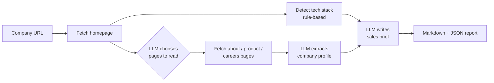
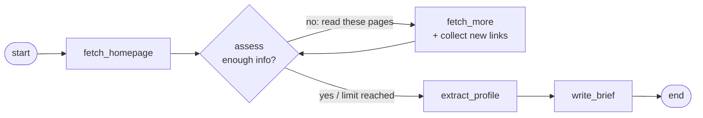

# Lead Research Agent

An AI agent that researches a company from its website and writes a sales brief: what the company does, its likely technology needs, questions to ask a CTO, and a personalised LinkedIn connection note.

I built it to speed up my own B2B outreach. Researching a prospect by hand takes 15–20 minutes. This takes under a minute and gives me a starting point I then check and edit.

```bash
python -m app.cli https://example.com
# ✓ Example Corp -> reports/example-com.md
```

It has two modes:

- **Simple agent:** chooses pages once from the homepage, then writes the brief. It's fast and predictable.
- **Loop agent (`--loop`):** built with **LangGraph**. It keeps asking itself what it still doesn't know, reads another page, and repeats until it has enough. It can follow a trail the homepage doesn't show, such as homepage → About → Team.

See [docs/sample-report.md](docs/sample-report.md) for what a brief looks like.

---

## How it works



1. **Fetch the homepage** and extract readable text and internal links (`app/fetcher.py`).
2. **Detect the front-end tech stack** from HTML fingerprints such as Next.js, HubSpot or Shopify (`app/tech_detect.py`). This step uses rules, not AI, so it is free and predictable.
3. **The agent decides where to look next.** The LLM reads the homepage links and picks the pages most likely to explain the business, such as About, Product and Careers. This decision is what makes it an agent rather than a fixed script. If the model's reply can't be parsed, a keyword fallback picks the pages instead.
4. **Read those pages.** Careers pages are especially useful because job ads reveal the tech stack and growth.
5. **Extract a structured profile** (`CompanyProfile`): name, offering, customers, size signals and hiring signals. The prompt tells the model to use only what the site says and to leave fields empty rather than guess.
6. **Write the brief** (`SalesBrief`) from the profile, the tech stack and a description of what *you* sell, set in `SELLER_DESCRIPTION`.

### Loop agent (LangGraph)



- **`assess`:** the LLM checks four things (what the company does, its customers, its size or stage, and hiring or tech signals), lists what's missing and picks the next pages to read.
- **`fetch_more`:** reads those pages and adds any new links it finds to the list of candidates, which is how the agent finds pages the homepage doesn't link to.
- **`route_after_assess`:** guarantees the loop ends. It stops when the model says it has enough, or when it hits `MAX_LOOP_PAGES` or `MAX_LOOP_ROUNDS`, or when no links remain. An agent loop needs hard limits enforced in code; the model's judgement alone isn't enough.
- **Agent trace:** every decision is recorded and printed in the report under "How the agent researched this", so you can see why it read each page.
- **Testable without LangGraph:** the nodes and the router are plain functions, and only `build_graph()` imports LangGraph.

### Design decisions

| Decision | Why |
|---|---|
| Any OpenAI-compatible API via plain HTTP | Runs free on a local model (Ollama) or on OpenAI by changing three settings. No SDK lock-in, and every request is visible in `app/llm.py`. |
| Pydantic models for every output | The LLM's JSON is validated, so a malformed reply fails clearly instead of producing a broken report. |
| JSON repair plus one retry | Models often wrap JSON in code fences or add a sentence. `parse_json` handles that, and `chat_json` asks again once if needed. |
| Rule-based tech detection | Cheaper and more reliable than asking an LLM to guess from HTML. |
| Respects `robots.txt` and reads at most 4 pages | Keeps the tool polite to the sites it visits. |
| Connection note clipped in code | The model is asked to keep it short, but the code enforces it, because LinkedIn notes have a hard limit. |
| LLM and fetcher are injectable | Tests use a fake website and a fake LLM, so they run offline in milliseconds. |

---

## Quick start

### 1. Install

```bash
git clone https://github.com/<your-username>/lead-research-agent.git
cd lead-research-agent
python -m venv .venv
source .venv/bin/activate          # Windows: .venv\Scripts\activate
pip install -r requirements.txt
cp .env.example .env               # Windows: copy .env.example .env
```

### 2. Choose a model

**Free and local (default):** install [Ollama](https://ollama.com), then run:
```bash
ollama pull llama3.1
```

**OpenAI:** edit `.env`:
```
LLM_BASE_URL=https://api.openai.com/v1
LLM_API_KEY=sk-...
LLM_MODEL=gpt-4o-mini
```

Edit `SELLER_DESCRIPTION` in `.env` so the briefs are written for what your company actually offers.

### 3. Run

**One company:**
```bash
python -m app.cli https://example.com -v
```

**A target list** (one URL per line, see `companies.example.txt`):
```bash
python -m app.cli --batch companies.txt
```
This writes a brief per company plus `reports/summary.csv`, which you can open in Excel or Google Sheets.

**Loop agent:**
```bash
python -m app.cli https://example.com --loop -v
```
`-v` prints each decision the agent makes as it runs.

**As an API:**
```bash
uvicorn app.api:app --reload
```
Then open http://localhost:8000/docs, or call it directly:
```bash
curl -X POST localhost:8000/research -H "Content-Type: application/json" \
     -d '{"url": "https://example.com"}'
# loop agent:
#    -d '{"url": "https://example.com", "loop": true}'
```

**With Docker:**
```bash
docker build -t lead-research-agent .
docker run -p 8000:8000 --env-file .env lead-research-agent
```
To use Ollama running on your own machine from inside Docker, set `LLM_BASE_URL=http://host.docker.internal:11434/v1`.

---

## Tests

```bash
pytest -v
```

The tests run offline against a fake website and a fake LLM. They cover HTML parsing, tech detection, JSON repair and retry, the agent's page choice and keyword fallback, skipping broken pages, connection-note length, report output and the API endpoints. For the loop agent, they check that it follows links found on later pages, respects the page and round limits, falls back when the model's reply is unusable, and runs end to end as a real LangGraph graph. GitHub Actions runs them on every push.

---

## Project structure

```
app/
  agent.py        simple agent: choose pages once, then write the brief
  graph_agent.py  loop agent: LangGraph state machine (assess -> fetch_more -> ...)
  fetcher.py      HTTP, robots.txt, HTML to text and links
  tech_detect.py  rule-based tech-stack fingerprints
  llm.py          OpenAI-compatible client and JSON parsing/retry
  prompts.py      every prompt, in one place
  models.py       Pydantic data models
  report.py       Markdown and JSON output
  cli.py          command line (single URL or batch)
  api.py          FastAPI app
tests/            offline tests with a fake website and fake LLM
```

## Limitations

- **Only sees what's public on the website.** It doesn't use LinkedIn, funding databases or news.
- **Tech detection covers the front end and marketing tools only.** Backend technology usually shows up only in job ads.
- **Sites built entirely in JavaScript** may return little text, because pages aren't rendered in a browser.
- **The output is a draft.** Check the facts and personalise the messages before sending anything.

## What I'd add next

- News and press-release search, so briefs mention recent events.
- Headless-browser rendering (Playwright) for JavaScript-heavy sites.
- Saving briefs to PostgreSQL, with a simple pipeline view.

## License

MIT
